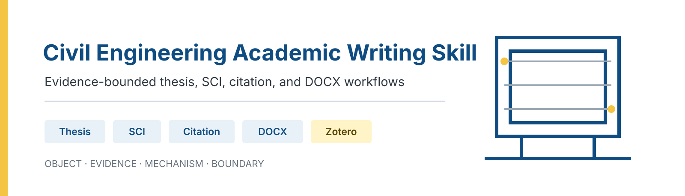
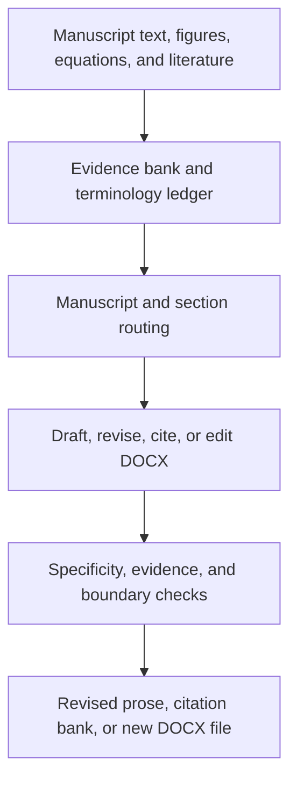

<div align="center">
  
  <p>
    <a href="https://github.com/JackYStack/civil-engineering-thesis-body-writing-skill/actions/workflows/validate.yml"></a>
    
    <a href="README.md"></a>
  </p>
  <p>
    <a href="#quick-start">Quick Start</a> ·
    <a href="#common-workflows">Workflows</a> ·
    <a href="#installation">Installation</a> ·
    <a href="#evidence-and-safety-boundaries">Boundaries</a> ·
    <a href="#validation">Validation</a> ·
    <a href="#acknowledgements-and-upstream-skills">Acknowledgements</a> ·
    <a href="README.md">中文</a>
  </p>
</div>

`civil-thesis-body-writing` is an Agent skill for civil-engineering theses and engineering-journal manuscripts, with Codex as its default installation target and adapters for Claude Code installation and WorkBuddy project installation/package import. It organizes research objects, data, figures, equations, and literature into evidence-bounded prose, with workflows for academic prose cleanup, reviewer-driven local revision, SCI compression, citation auditing, DOCX creation/conversion/safe revision, and InstSci/Zotero-assisted literature management. Language work distinguishes minimal cleanup, regular polishing, and drafting while preserving scholarly register, author voice, and necessary technical content.

> It does not invent data, equations, experimental results, or references, and it does not present machine-learning predictions or GUI outputs as design-code conclusions.

## Quick Start

1. Run `git clone https://github.com/JackYStack/civil-engineering-thesis-body-writing-skill.git`, or select `Code -> Download ZIP` on the GitHub repository page and fully extract it.
2. From the repository or extracted directory, run `.\scripts\install.ps1` in Windows PowerShell or `bash scripts/install.sh` in Linux/macOS Bash.
3. Restart Codex and send: `Use civil-thesis-body-writing to revise this civil-engineering manuscript section. Preserve data, terminology, equations, and citations, and do not add conclusions unsupported by the supplied evidence.`

## Common Workflows

| Goal | Copy-ready prompt |
| --- | --- |
| Revise a thesis subsection | `Use civil-thesis-body-writing to revise this subsection. Preserve figures, equations, parameters, and citations; remove vague claims; and list missing evidence.` |
| Minimally clean final text | `Use civil-thesis-body-writing for minimal cleanup of this final text. Change only identifiable stock phrases or expression defects. Leave other wording, paragraph structure, terms, numbers, equations, and citations unchanged, and preserve genuine uncertainty.` |
| Make a reviewer-driven local amendment | `Use civil-thesis-body-writing to address this reviewer comment in the relevant passage only. Preserve the author's voice and give a searchable insertion or replacement location, revised text, and a brief explanation. Do not invent page or line numbers.` |
| Clarify the argument and contribution | `Use civil-thesis-body-writing to organize this section around its strongest supported contribution. Remove redundant self-defense without hiding material adverse findings, necessary assumptions, or applicability conditions.` |
| Audit or reduce citations | `Use civil-thesis-body-writing to identify which sentence each source supports and grade it as strong, partial, background, or not recommended.` |
| Create, convert, or safely revise Word | `Use civil-thesis-body-writing for this Word task. First classify it as creation, Markdown conversion, or existing-DOCX revision; then follow the institution/journal template and validate equations, numbering, fields, and compatibility.` |
| Organize InstSci/Zotero results | `Use civil-thesis-body-writing to organize these search results and show a deduplicated Zotero import preview before writing to the library.` |
| Polish for a target journal | `Use civil-thesis-body-writing to research the target journal and comparable papers, report structural and depth differences, and then propose a full-manuscript revision plan.` |
| Plan or generate a scientific figure | `Use civil-thesis-body-writing to establish the claim, data, and panel brief; hand plotting, export, and QA to nature-figure; then revise the caption and results text.` |

## How It Works



## Capabilities

| Workflow | Direct deliverable | Governing boundary |
| --- | --- | --- |
| Thesis body writing | Chinese prose organized for the selected chapter task | User figures, equations, and data remain the primary evidence |
| Paper/SCI writing | Abstract, introduction, results/discussion, conclusion, title, and highlights | Compress around one central question without expanding conclusions |
| Academic prose cleanup | Revised prose and notes at cleanup, polish, or draft intensity | No mechanical word bans or forced sentence variation; check numbers, terms, citations, and their semantic mappings |
| Reviewer-driven local revision | Insertion/replacement anchors, revised passages, and reply-handoff information | Preserve sound original text; distinguish proposals from implemented edits; cooperate with `nature-response` for reply-package assembly only when needed |
| Contribution-led, non-defensive writing | Evidence-led central claim, experiment roles, and section argument | Remove rhetorical self-defense, not necessary disclosure; do not turn a local advantage into universal superiority |
| Citation support | Temporary markers, candidate list, and support grades | Search hits and title similarity are not full-text support |
| DOCX creation and revision | A new, converted, or structure-preserving document version | Template first; do not overwrite by default; validate native Word objects and rendering |
| InstSci/Zotero | Retrieval organization, import preview, and duplicate checks | Confirm before library writes; access success is not citation support |
| Target-journal polishing | Journal requirements, exemplar differences, and a revision blueprint | Research before rewriting; do not imitate exemplar wording |
| Format and final audit | Rule authority, format ledger, readiness gate, and fix preview | Generic rules do not prove institutional compliance; skipped checks are not passes |
| Scientific-figure cooperation | Figure brief, semantic colour mapping, nature-figure handoff, artifact QA, and manuscript reintegration | The writing skill does not bypass the Python/R gate or claim artifacts without data and inspected files |

See the [academic prose cleanup guide](references/style/academic-prose-cleanup.md), [reviewer-driven revision workflow](references/workflows/reviewer-driven-revision.md), and [anti-defensive writing guide](references/architecture/evidence-led-narrative-and-defensive-writing.md). The three language-editing intensities operate within the existing draft/revise routes; they are not separately installed skills.

## Installation

### Claude Code and WorkBuddy

Run these commands from the repository root with Python 3.10+. Codex users can continue using the existing installers below.

```shell
python -X utf8 scripts/install_agent.py install --agent claude-code --scope user
python -X utf8 scripts/install_agent.py install --agent workbuddy --scope project --project-root "/path/to/project"
python -X utf8 scripts/install_agent.py package --agent workbuddy --output "/path/to/output/civil-thesis-body-writing-workbuddy.zip"
```

Invoke `/civil-thesis-body-writing` in Claude Code. In WorkBuddy, use a project supporting local `.codebuddy/` configuration, or upload the exported package on the Skills page and complete its security review. The adapter does not guess a global directory or deploy to cloud libraries. Existing installations are refused by default; use `--replace` only after review to retain a backup before updating.

The hosts share writing rules, not MCP connections, permissions, credentials, or companion skills. Missing external services, Word/PDF rendering, or `nature-figure` capabilities are skipped and reported, never simulated with prose. Installation/package compatibility does not establish successful discovery or execution inside the client. See the [agent compatibility guide](references/workflows/agent-compatibility.md) for the complete setup and capability matrix.

### Install from the repository (recommended)

- **Prerequisite:** Codex, access to the GitHub repository, Git or a browser, and either PowerShell or Bash.
- **Action:** Run `git clone https://github.com/JackYStack/civil-engineering-thesis-body-writing-skill.git`, or select `Code -> Download ZIP` on the repository page and fully extract it; then run `.\scripts\install.ps1` on Windows or `bash scripts/install.sh` on Linux/macOS from that directory.
- **Default destination:** `$HOME\.codex\skills\civil-thesis-body-writing` on Windows; `${CODEX_HOME:-$HOME/.codex}/skills/civil-thesis-body-writing` on Linux/macOS.
- **Existing installation:** The installer first renames the existing directory beside it as `civil-thesis-body-writing.bak-YYYYMMDD-HHMMSS`, then copies the current repository contents.
- **Restart:** Restart Codex after installation.
- **Verify:** Run the [shared verification prompt](#verify-the-installation).

### Windows

- **Prerequisite:** Codex and PowerShell, plus a complete repository directory containing `SKILL.md`, `manifest.yaml`, `static/`, `references/`, `scripts/`, and `agents/`.
- **Action:** Run this command from that directory:

```powershell
.\scripts\install.ps1
```

- **Default destination:** `$HOME\.codex\skills\civil-thesis-body-writing`.
- **Existing installation:** The script first renames the existing directory beside it as `civil-thesis-body-writing.bak-YYYYMMDD-HHMMSS`.
- **Restart:** Restart Codex after installation.
- **Verify:** Run the [shared verification prompt](#verify-the-installation).

### Linux/macOS

- **Prerequisite:** Codex and Bash, plus a complete repository directory.
- **Action:** Run this command from that directory:

```bash
bash scripts/install.sh
```

- **Default destination:** `${CODEX_HOME:-$HOME/.codex}/skills/civil-thesis-body-writing`.
- **Existing installation:** The script first renames the existing directory beside it as `civil-thesis-body-writing.bak-YYYYMMDD-HHMMSS`.
- **Restart:** Restart Codex after installation.
- **Verify:** Run the [shared verification prompt](#verify-the-installation).

The shell installer is covered by repository content validation. This repository does not claim a completed Linux/macOS execution smoke test on the maintainer's machine.

### Manual installation

- **Prerequisite:** Codex, a complete `civil-thesis-body-writing` folder, and write access to the Codex skills directory.
- **Action:** Apply the backup rule below, copy the complete folder to the default destination, and confirm that `SKILL.md` is directly inside the destination; use the equivalent location when Codex has a custom skills root.
- **Default destination:** `$HOME\.codex\skills\civil-thesis-body-writing` on Windows; `${CODEX_HOME:-$HOME/.codex}/skills/civil-thesis-body-writing` on Linux/macOS.
- **Existing installation:** Manual copying does not create a backup; before copying, rename the existing directory to `civil-thesis-body-writing.bak-YYYYMMDD-HHMMSS`.
- **Restart:** Restart Codex after copying.
- **Verify:** Run the [shared verification prompt](#verify-the-installation).

### Verify the installation

Every installation route uses the same verification prompt:

```text
Use civil-thesis-body-writing to check this civil-engineering paragraph for vague conclusions and identify the evidence needed to support them.
```

## Evidence and Safety Boundaries

- Claims from the author's experiments, finite-element models, machine-learning models, and GUI should be supported first by the manuscript's own figures, equations, outputs, and parameter ranges.
- External literature supports background, method provenance, mechanism interpretation, and comparison; it does not replace the author's results.
- Zotero metadata, abstracts, and download status are not sufficient sentence-level citation evidence.
- Design values, resistance claims, and code-related conclusions must retain their loading conditions, parameter ranges, and standard basis.
- DOCX work first selects creation, conversion, or revision; institution/journal templates override generic defaults, existing files are preserved by default, and formulas, fields, comments, tracked changes, and numbering are checked as Word objects.
- Minimal cleanup does not authorize structural rewriting; regular polishing does not authorize new facts. Check both literal values and their mappings to models, metrics, conditions, and citation-supported claims.
- Anti-defensive writing does not mean deleting negative results. Preserve material adverse findings, modeling assumptions, applicability conditions, and genuine uncertainty; do not add a generic limitations paragraph by default.
- Prose cleanup targets clarity, accuracy, and scholarly register. It does not promise AI-detector scores or remove institution- or venue-required AI-assistance disclosures.

## Examples and Recipes

- [Public usage recipes](references/examples/public-usage-recipes.md)
- [Task-specific templates](references/examples/use-case-templates.md)
- [Complete reference index](references/index.md)

## Validation

<details>
<summary>Run the complete validation suite</summary>

Use the repository-specific `.venv-validation` for local validation so PyYAML is not installed into the skill runtime or a shared Python environment.

Windows PowerShell:

```powershell
python -m venv .venv-validation
.\.venv-validation\Scripts\python.exe -m pip install -r requirements-validation.txt
.\.venv-validation\Scripts\python.exe -X utf8 scripts\validate_all.py .
```

Linux/macOS Bash:

```bash
python3 -m venv .venv-validation
./.venv-validation/bin/python -m pip install -r requirements-validation.txt
./.venv-validation/bin/python -X utf8 scripts/validate_all.py .
```

Both dependency installation and validation call the virtual environment interpreter directly, so activation is not required. PyYAML is required only for repository validation; the skill runtime remains dependency-free. The complete entry point checks the router, manifest, output contracts, pressure tests, forward tests, writing style, citation workflow, public distribution, and privacy rules. GitHub Actions runs the same entry point on pushes to main, pull requests, and manual dispatch.
</details>

## Repository Structure

<details>
<summary>View directory responsibilities</summary>

```text
civil-thesis-body-writing/
  SKILL.md                 # Lightweight router
  manifest.yaml            # Mode, section, source, and operation map
  static/                  # Core rules and task fragments
  references/              # On-demand workflows, styles, and examples
  scripts/                 # Installers and deterministic validators
  agents/openai.yaml       # Codex UI metadata
  .github/                 # CI and structured issue intake
```
</details>

## Repository Distribution And Privacy

Repository commits and distributed copies must not contain private local paths, Zotero storage keys, real paper lists, access credentials, unpublished data, or user manuscripts. Maintainers run full validation before pushing or merging; users obtain the current contents by cloning the repository or selecting `Code -> Download ZIP`.

## Support

- [Report a reproducible problem](https://github.com/JackYStack/civil-engineering-thesis-body-writing-skill/issues/new?template=bug-report.yml)
- [Propose a reusable workflow](https://github.com/JackYStack/civil-engineering-thesis-body-writing-skill/issues/new?template=workflow-request.yml)

Remove manuscript text, private paths, credentials, and unpublished research data before submitting an issue.

This is a public repository. Issue Form `required` settings provide a structured confirmation only; issue content may be visible to anyone, and the form cannot prevent disclosure of sensitive information. Do not submit manuscripts, private paths, credentials, Zotero storage keys, or unpublished data.

## Acknowledgements And Upstream Skills

This skill's architecture and several generalized workflows were informed by the following public projects. We thank their authors and maintainers:

- [Gostyan/docx-skill-4-cn-paper](https://github.com/Gostyan/docx-skill-4-cn-paper): DOCX creation/conversion/revision branches and formatting validation.
- [Yuan1z0825/nature-skills](https://github.com/Yuan1z0825/nature-skills): router/manifest architecture, academic-writing methods, and the bounded `nature-figure` cooperation route.
- [WUBING2023/PaperSpine](https://github.com/WUBING2023/PaperSpine): motivation threads, evidence banks, writing-rationale matrices, and logic-transfer audits.
- [google-deepmind/science-skills](https://github.com/google-deepmind/science-skills): external-tool records, source status, and evidence boundaries.
- [Rimagination/instsci](https://github.com/Rimagination/instsci): paper retrieval, access-status records, and Zotero handoff.
- [quzhiii/thesis-skills](https://github.com/quzhiii/thesis-skills): thesis formatting, final-readiness, and deterministic audit concepts.
- [zsyggg/paper-craft-skills](https://github.com/zsyggg/paper-craft-skills): consulted for general paper-reading and presentation workflow awareness.
- [Adkid-Zephyr/anti-defensive-writing-Skill](https://github.com/Adkid-Zephyr/anti-defensive-writing-Skill): evidence-led claims, clear experiment roles, and precise revision of defensive prose.
- [matsuikentaro1/humanizer_academic](https://github.com/matsuikentaro1/humanizer_academic): clarity before compression, explicit comparators and conditions, clear referents, and protection of substantive academic phrasing.
- [AIScientists-Dev/academic-humanizer](https://github.com/AIScientists-Dev/academic-humanizer): claim-evidence calibration, author-voice matching, and scholarly register protection.
- [junbolian/Academic-Humanizer](https://github.com/junbolian/Academic-Humanizer): editing intensity, located reasons for changes, and comparison of protected data, citations, and qualifiers.
- [taehyeonglim/academic-humanizer](https://github.com/taehyeonglim/academic-humanizer): academic register protection for genuine uncertainty, method passive voice, technical vocabulary, and range punctuation.

See the [External Skill Sources and Migration Ledger](references/meta/external-skill-sources.md) for reviewed revisions, reported licences, migration status, retained and excluded material, and internal destinations. This project retains generalized rules in original wording or uses explicit cooperation interfaces; it does not implicitly redistribute upstream scripts, data, examples, or branding. Upstream repository licences remain authoritative.
