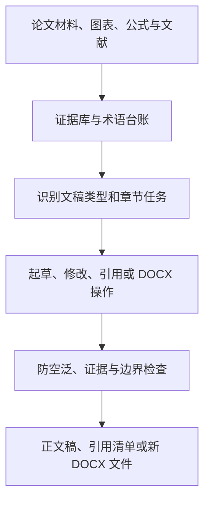

<div align="center">
  
  <p>
    <a href="https://github.com/JackYStack/civil-engineering-thesis-body-writing-skill/actions/workflows/validate.yml"></a>
    
    <a href="README.en.md"></a>
  </p>
  <p>
    <a href="#快速使用">快速使用</a> ·
    <a href="#常用任务模板">任务模板</a> ·
    <a href="#安装">安装</a> ·
    <a href="#使用边界">使用边界</a> ·
    <a href="#验证">验证</a> ·
    <a href="#致谢与参考来源">致谢</a> ·
    <a href="README.en.md">English</a>
  </p>
</div>

`civil-thesis-body-writing` 是面向土木工程学位论文与工程期刊稿件的 Codex skill。它将研究对象、数据、图表、公式和文献组织成有证据边界的正文，并支持学术表达清理、审稿意见驱动的局部修改、SCI 压缩、引用核查、DOCX 创建/转换/安全修改以及 InstSci/Zotero 文献流程。语言修改区分最小清理、常规润色和新稿写作，保留专业语气、作者风格与必要技术信息。

> 它不会替你编造数据、公式、试验结果或参考文献，也不会把机器学习预测或 GUI 输出写成规范设计结论。

## 快速使用

1. 使用 `git clone https://github.com/JackYStack/civil-engineering-thesis-body-writing-skill.git` 获取仓库，或在 GitHub 仓库页面选择 `Code -> Download ZIP` 并完整解压。
2. 在仓库或解压目录按平台运行安装命令：Windows PowerShell 使用 `.\scripts\install.ps1`；Linux/macOS Bash 使用 `bash scripts/install.sh`。
3. 重启 Codex，然后发送：`使用 civil-thesis-body-writing 修改这段土木工程论文正文，保留数据、术语、公式和引用，不补写没有证据的结论。`

## 常用任务模板

| 想完成的任务 | 可直接使用的提示词 |
| --- | --- |
| 修改学位论文小节 | `使用 civil-thesis-body-writing 修改这一小节。保留图表、公式、参数和引用，删除空泛判断，并列出缺少的证据。` |
| 定稿最小清理 | `使用 civil-thesis-body-writing 对这段定稿做最小清理，只改可定位的套话或表达缺陷。其余文字、段落结构、术语、数字、公式和引用不动，保留真实不确定性。` |
| 按审稿意见微修 | `使用 civil-thesis-body-writing 回应这条审稿意见，只修改相关段落，保留原文风格。给出可检索的插入或替换位置、修改稿和简短说明，不编造页码或行号。` |
| 梳理论证与贡献 | `使用 civil-thesis-body-writing 围绕最有证据支持的贡献梳理本节论证，删除冗余自辩，不隐瞒影响结论的不利发现、必要假设或适用条件。` |
| 核查或精简引用 | `使用 civil-thesis-body-writing 核查这些引用分别支持哪一句话，按强支持、部分支持、背景支持和不建议引用分级。` |
| 创建、转换或安全修改 Word 稿件 | `使用 civil-thesis-body-writing 处理这个 Word 任务。先区分新建、Markdown 转换或已有 DOCX 修订，再按学校/期刊模板生成新文件并校核公式、编号、域和兼容性。` |
| 整理 InstSci/Zotero 文献 | `使用 civil-thesis-body-writing 整理这些检索结果，先给 Zotero 导入预览和查重结果，不直接写入文库。` |
| 按目标期刊润色 | `使用 civil-thesis-body-writing 调研目标期刊与同方向范文，先给出结构和深度差异，再制定整篇修改方案。` |
| 规划或生成科研图表 | `使用 civil-thesis-body-writing 先建立图件论点、数据和面板 brief，再调用 nature-figure 绘图、导出和 QA，最后补写图题与结果段。` |

## 工作方式



## 主要能力

| 工作流 | 直接产物 | 关键边界 |
| --- | --- | --- |
| 学位论文正文 | 按章节任务组织的中文正文 | 以用户图表、公式和数据为主要证据 |
| 小论文/SCI | 摘要、引言、结果讨论、结论与亮点 | 围绕单一中心问题压缩，不扩大结论 |
| 学术表达清理 | 按最小清理、常规润色或新稿写作强度处理的正文与修改说明 | 不机械禁词或强制句式变化；核对数字、术语、引用及其对应关系 |
| 审稿局部修订 | 对应审稿问题的插入/替换位置、修改段落及回复交接信息 | 保留有效原文；区分建议修改与实际完成；仅在需要时协作 `nature-response` 组装回复包 |
| 贡献组织与反防御性写作 | 以证据组织的中心主张、实验职责与章节论证 | 删除冗余自辩而非必要披露，不把局部优势写成全面领先 |
| 引用核查 | 临时引用、候选清单与支持等级 | 检索命中或题名相似不等于全文支持 |
| DOCX 创建与修改 | 新建、Markdown 转换或保留格式的修订版本 | 模板优先；默认不覆盖原文件；检查原生 Word 对象和渲染结果 |
| InstSci/Zotero | 检索整理、导入预览与查重结果 | 写入文库前确认，访问成功不等于可引用 |
| 目标期刊润色 | 期刊要求、范文差异与全文修改蓝图 | 先调研后重写，不机械模仿范文句式 |
| 格式与终稿审查 | 规则依据、格式问题台账、Readiness Gate 与修复预览 | 通用规则不等于学校合规；跳过的检查不能记为通过 |
| 科研图表协作 | 图件 brief、语义化配色、nature-figure 绘图交接、产物 QA 与正文再集成 | 正文 Skill 不绕过 Python/R 后端门；没有数据或产物时不声称已生成 |

具体规则见[学术表达清理指南](references/style/academic-prose-cleanup.md)、[审稿局部修订流程](references/workflows/reviewer-driven-revision.md)和[反防御性写作指南](references/architecture/evidence-led-narrative-and-defensive-writing.md)。三种语言处理强度沿用现有起草/修订操作，不是额外安装的独立 skill。

## 安装

### 从仓库安装（推荐）

- **前提条件：** 已安装 Codex，可访问 GitHub 仓库，并具备 Git 或浏览器，以及 PowerShell 或 Bash。
- **操作：** 运行 `git clone https://github.com/JackYStack/civil-engineering-thesis-body-writing-skill.git`，或在仓库页面选择 `Code -> Download ZIP` 并完整解压；随后在仓库目录运行 Windows 的 `.\scripts\install.ps1` 或 Linux/macOS 的 `bash scripts/install.sh`。
- **默认目标：** Windows 为 `$HOME\.codex\skills\civil-thesis-body-writing`；Linux/macOS 为 `${CODEX_HOME:-$HOME/.codex}/skills/civil-thesis-body-writing`。
- **已有安装：** 安装脚本先把已有目录重命名为同级的 `civil-thesis-body-writing.bak-YYYYMMDD-HHMMSS`，再复制当前仓库内容。
- **重启：** 安装完成后重启 Codex。
- **验证：** 运行[共享验证提示词](#安装验证)。

### Windows

- **前提条件：** 已安装 Codex 和 PowerShell，并已取得包含 `SKILL.md`、`manifest.yaml`、`static/`、`references/`、`scripts/` 与 `agents/` 的完整仓库目录。
- **操作：** 在该目录运行：

```powershell
.\scripts\install.ps1
```

- **默认目标：** `$HOME\.codex\skills\civil-thesis-body-writing`。
- **已有安装：** 脚本先把已有目录重命名为同级的 `civil-thesis-body-writing.bak-YYYYMMDD-HHMMSS`。
- **重启：** 安装完成后重启 Codex。
- **验证：** 运行[共享验证提示词](#安装验证)。

### Linux/macOS

- **前提条件：** 已安装 Codex 和 Bash，并已取得完整仓库目录。
- **操作：** 在该目录运行：

```bash
bash scripts/install.sh
```

- **默认目标：** `${CODEX_HOME:-$HOME/.codex}/skills/civil-thesis-body-writing`。
- **已有安装：** 脚本先把已有目录重命名为同级的 `civil-thesis-body-writing.bak-YYYYMMDD-HHMMSS`。
- **重启：** 安装完成后重启 Codex。
- **验证：** 运行[共享验证提示词](#安装验证)。

该脚本已纳入仓库内容校验；当前仓库不声明已在维护者机器完成 Linux/macOS 执行冒烟测试。

### 手动安装

- **前提条件：** 已安装 Codex，已取得完整 `civil-thesis-body-writing` 文件夹，并可写入 Codex skills 目录。
- **操作：** 先按下述备份规则处理已有目录，再把完整文件夹复制到默认目标，确认目标文件夹内直接包含 `SKILL.md`；也可在 Codex 自定义 skills 根目录执行同等复制操作。
- **默认目标：** Windows 为 `$HOME\.codex\skills\civil-thesis-body-writing`；Linux/macOS 为 `${CODEX_HOME:-$HOME/.codex}/skills/civil-thesis-body-writing`。
- **已有安装：** 手动安装不会自动备份；复制前把已有目录重命名为 `civil-thesis-body-writing.bak-YYYYMMDD-HHMMSS`。
- **重启：** 复制完成后重启 Codex。
- **验证：** 运行[共享验证提示词](#安装验证)。

### 安装验证

所有安装路线使用同一验证提示词：

```text
使用 civil-thesis-body-writing 检查这段土木工程论文正文是否存在空泛结论，并说明缺少哪些证据。
```

## 使用边界

- 本文试验、有限元、机器学习和 GUI 结论优先由本文图表、公式、模型输出及参数范围支持。
- 外部文献用于背景、方法来源、机理解释和横向比较，不替代本文结果。
- Zotero 元数据、摘要和下载状态不能单独作为句子级引用证据。
- 设计值、承载力和规范性结论必须保留适用工况、参数范围和标准依据。
- DOCX 任务先区分新建、转换和修订；学校/期刊模板高于通用格式，已有文件默认不覆盖，公式、域、批注、修订和编号需按对象校核。
- 最小清理不授权结构重写；常规润色不擅自补充事实。修改既核对字面值，也核对数值对应的模型、指标、工况以及引用支持的主张。
- 反防御性写作不等于删除负面结果。保留影响解释的重要不利发现、建模假设、适用条件和真实不确定性，不默认添加泛化的局限性段落。
- 表达清理以清楚、准确和专业语域为目标，不承诺 AI 检测分数，也不删除学校或期刊要求的 AI 辅助使用声明。

## 示例与模板

- [公开使用配方](references/examples/public-usage-recipes.md)
- [分场景任务模板](references/examples/use-case-templates.md)
- [完整参考索引](references/index.md)

## 验证

<details>
<summary>运行完整验证</summary>

本地验证使用仓库专用的 `.venv-validation`，不把 PyYAML 安装到 skill 运行环境或共享 Python 环境。

Windows PowerShell：

```powershell
python -m venv .venv-validation
.\.venv-validation\Scripts\python.exe -m pip install -r requirements-validation.txt
.\.venv-validation\Scripts\python.exe -X utf8 scripts\validate_all.py .
```

Linux/macOS Bash：

```bash
python3 -m venv .venv-validation
./.venv-validation/bin/python -m pip install -r requirements-validation.txt
./.venv-validation/bin/python -X utf8 scripts/validate_all.py .
```

安装依赖和运行验证都直接调用该虚拟环境的 Python，无需激活环境。PyYAML 仅用于仓库验证，skill 运行时不依赖它。完整入口检查 router、manifest、输出契约、压力测试、前向测试、写作风格、引用工作流、公开分发和隐私规则。GitHub Actions 在推送到 main、pull request 和手动触发时运行同一入口。
</details>

## 项目结构

<details>
<summary>查看目录职责</summary>

```text
civil-thesis-body-writing/
  SKILL.md                 # 轻量 router
  manifest.yaml            # 模式、章节、来源和操作映射
  static/                  # 核心规则与任务碎片
  references/              # 按需加载的工作流、风格与案例
  scripts/                 # 安装脚本和确定性验证器
  agents/openai.yaml       # Codex UI 元数据
  .github/                 # CI 与问题反馈表单
```
</details>

## 仓库分发与隐私

仓库提交与对外分发内容不应包含本地私人路径、Zotero storage key、真实论文清单、访问凭据、未公开数据或用户稿件。维护者在推送或合并前运行完整验证；使用者通过克隆仓库或 `Code -> Download ZIP` 获取当前内容。

## 问题反馈

- [提交可复现问题](https://github.com/JackYStack/civil-engineering-thesis-body-writing-skill/issues/new?template=bug-report.yml)
- [提出可复用工作流需求](https://github.com/JackYStack/civil-engineering-thesis-body-writing-skill/issues/new?template=workflow-request.yml)

提交前删除稿件原文、私人路径、凭据和未公开研究数据。

本仓库为公开仓库。Issue Form 的 `required` 设置仅作为结构化确认；Issue 内容可能被任何人查看，表单本身不能阻止敏感信息披露。请勿提交稿件、私人路径、凭据、Zotero storage key 或未公开数据。

## 致谢与参考来源

本 Skill 的架构和部分通用工作流受以下公开项目启发。感谢这些项目的作者与维护者：

- [Gostyan/docx-skill-4-cn-paper](https://github.com/Gostyan/docx-skill-4-cn-paper)：DOCX 新建、转换、修订分支及格式验证思路。
- [Yuan1z0825/nature-skills](https://github.com/Yuan1z0825/nature-skills)：router/manifest 架构、学术写作方法和 `nature-figure` 协作边界。
- [WUBING2023/PaperSpine](https://github.com/WUBING2023/PaperSpine)：论证主线、证据库、写作理由矩阵和逻辑迁移审查。
- [google-deepmind/science-skills](https://github.com/google-deepmind/science-skills)：外部工具调用、来源状态和证据边界规则。
- [Rimagination/instsci](https://github.com/Rimagination/instsci)：论文获取、访问状态记录和 Zotero 交接流程。
- [quzhiii/thesis-skills](https://github.com/quzhiii/thesis-skills)：论文格式、终稿 readiness 和确定性审查方法。
- [zsyggg/paper-craft-skills](https://github.com/zsyggg/paper-craft-skills)：论文阅读与展示工作流参考。
- [Adkid-Zephyr/anti-defensive-writing-Skill](https://github.com/Adkid-Zephyr/anti-defensive-writing-Skill)：以证据组织主张、明确实验职责和精简防御性表述的写作规则。
- [matsuikentaro1/humanizer_academic](https://github.com/matsuikentaro1/humanizer_academic)：清楚优先于压缩，明确比较对象、条件与指代，保留有内容的学术表达。
- [AIScientists-Dev/academic-humanizer](https://github.com/AIScientists-Dev/academic-humanizer)：主张强度与证据匹配、作者风格校准及学术语气保护。
- [junbolian/Academic-Humanizer](https://github.com/junbolian/Academic-Humanizer)：分级编辑强度、可定位的修改理由，以及数据、引用与限定语的对照核查。
- [taehyeonglim/academic-humanizer](https://github.com/taehyeonglim/academic-humanizer)：学术语域保护，保留真实不确定性、方法被动语态、专业词汇和范围符号。

各项目的审阅版本、许可证、迁移状态、保留内容、未迁移内容及本 Skill 内部落点，见[外部 Skill 来源与迁移索引](references/meta/external-skill-sources.md)。本项目仅以重新表述的规则或显式协作接口吸收通用方法，不默认复制上游脚本、数据、示例或品牌规范；具体许可证仍以各上游仓库为准。
